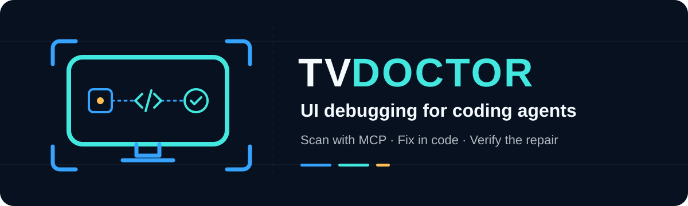

# TVDoctor

<p align="center">
  <a href="https://github.com/Ticklect/tvdoctor/actions/workflows/ci.yml"></a>
  <a href="LICENSE"></a>
  <a href="package.json"></a>
</p>

**Local MCP tools for finding UI bugs and verifying your coding agent’s fixes.**

TVDoctor gives Codex, Claude Code, and other MCP-capable agents an independent
view of a running web app. It explores keyboard navigation, returns
evidence-backed findings, and retests supported failures after your agent
changes the source. TVDoctor runs the scanner and stores its evidence on your
machine.

## Connect your coding agent

From the TVDoctor source checkout, use Node 22.13+ or 24. Install dependencies,
build the packages, and install the matching Chromium runtime.

```sh
npm ci
npm run build:packages
npm run tvdoctor -- setup
```

From the same directory, register the server with the agent you use.

**Codex**

```sh
codex mcp add tvdoctor -- node "$PWD/packages/cli/dist/mcp-bin.js"
```

**Claude Code**

```sh
claude mcp add --scope user --transport stdio tvdoctor -- node "$PWD/packages/cli/dist/mcp-bin.js"
```

Open a new agent session in the project you want to test, start its local
development server, and give the agent its URL. Replace the example address
with your own.

> I authorize testing my local app at `http://127.0.0.1:5173/`. Use TVDoctor
> to scan its keyboard navigation and inspect the evidence. Fix a confirmed
> issue in the source, then verify the original finding if its rule is
> supported. Report what was verified and what coverage remains untested.

If your client exposes MCP prompts, select `tvdoctor_repair_workflow` for the
same guided workflow.

1. **Scan.** The agent calls `tvdoctor_scan` and polls `tvdoctor_status`. The
   response distinguishes completed, partial, failed, and cancelled runs.
2. **Read the evidence.** `tvdoctor_triage` prioritizes findings on a completed
   single-page scan. `tvdoctor_findings` gives observed issues and coverage,
   and `tvdoctor_issue_details` gives available reproduction steps.
3. **Fix the code.** The agent uses the observations to locate the cause in
   your project, edits the source, and reloads or restarts the app.
4. **Verify the original.** The agent calls `tvdoctor_verify_fix` with the
   original scan and issue IDs. A supported replay returns `FIXED`,
   `REPRODUCED`, or `INCONCLUSIVE`. A fresh matching scan and `tvdoctor_compare`
   provide a separate regression check.

Keep the original MCP session open through verification. Scan IDs and their
evidence belong to that session. See the [MCP setup and tool guide](docs/mcp-server.md)
for Cursor, VS Code, other MCP clients, and additional scan modes.

## Current scope

TVDoctor's local MCP server supports browser keyboard scans, bounded site
discovery, responsive review, and evidence-backed findings.
Web and MCP support are Experimental. Independent fix verification covers eligible
original modal-focus failures, including focus escape, Tab focus loss, and
failure to move focus into a newly opened modal.

- **VERIFIED** means the original scan captured deterministic failure evidence.
  A supported original finding must replay as **FIXED** to verify a repair.
- **REVIEW** means a result needs further investigation, such as a layout
  heuristic or an observed JavaScript exception.
- **UNTESTED** means the required coverage or evidence was unavailable.
  Report the termination reason and remaining work for partial scans.

Compare only compatible completed scans. A missing finding in a follow-up scan
does not prove the repair. [MCP tool guide](docs/mcp-server.md) ·
[Known limitations](docs/limitations.md)

## Run the same checks outside an agent

### Source checkout

Use the CLI for scripts and CI, or open the local dashboard to inspect
findings and evidence. Start an authorised local app first.

```sh
npm run tvdoctor -- scan http://127.0.0.1:5173/ --input keyboard
npm run tvdoctor -- ui
```

[CLI and CI workflow](docs/cli-workflow.md) · [CLI command reference](packages/cli/README.md)

### Windows release bundle

TVDoctor is not published to npm yet. The
[v0.1.0 Windows ZIP](https://github.com/Ticklect/tvdoctor/releases/tag/v0.1.0)
is an earlier TV-navigation preview. The MCP server requires the current source
checkout.

## Try the packaged demo

From the source checkout, run `npm run build` and
`npm run tvdoctor -- setup`, then `npm run tvdoctor -- demo`. The bundled
Northstar fixture reproduces its seeded Home `More info` focus failure
(`remote.reachability`) in **6 actions, 1 state, 1 issue**. The replay returns
`REPRODUCED`. This is controlled seeded evidence, not a measure of production accuracy.
[Sample report](docs/sample-report.md) · [Demo details](docs/demo.md)

## Experimental boundaries

TV remote and D-pad navigation remain available through the shared engine.
Android TV is Experimental. Check the driver guides for setup and the current
physical-device evidence. [TV navigation examples](docs/examples.md) ·
[Android TV driver](docs/drivers/android.md)

TVDoctor keeps evidence on the local machine. Treat screenshots and visible
app content as sensitive. Review report artifacts before sharing. The CLI
provides `tvdoctor privacy`, `--no-screenshots`, and
`--target-redaction origin`. Session video is opt-in with `--record-video`.
[Privacy guide](docs/privacy.md)

## CLI exit codes

| Code | Meaning |
| ---: | --- |
| `0` | Completed under the requested failure policy. The seeded demo also uses `0` when its original issue reproduces. |
| `1` | Findings failed policy, a standalone replay reproduced the issue, a baseline regressed, or a required environment is unavailable. |
| `2` | Command usage is invalid. |
| `3` | Result is partial or inconclusive. |
| `4` | Execution failed before a trustworthy result was produced. |

A standalone replay that returns `REPRODUCED` exits `1`.

## Contributing

[Contribution guide](CONTRIBUTING.md) · [Security policy](SECURITY.md) ·
[AGPL-3.0-only licence](LICENSE)
