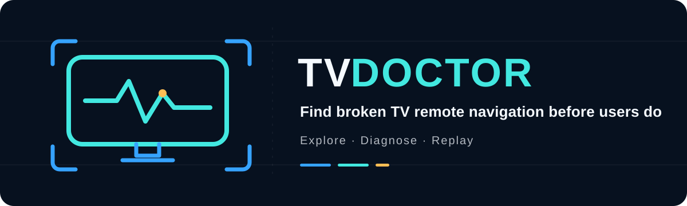

# TVDoctor

<p align="center">
  <a href="https://github.com/Ticklect/tvdoctor/actions/workflows/ci.yml"></a>
  <a href="LICENSE"></a>
  <a href="package.json"></a>
  <a href="https://github.com/Ticklect/tvdoctor/releases/tag/v0.1.0"></a>
</p>

**Find broken TV remote navigation before users do.**

TVDoctor automatically explores a TV interface with Up, Down, Left, Right,
Select, and Back, builds a focus/navigation graph, and reports deterministic
remote-navigation failures with evidence and replay data. For an app that opens
on the surface you want to test, you do not have to hand-author a navigation
script or enumerate every route first.

TVDoctor runs locally. The core workflow does not require an AI service, cloud
account, API key, or telemetry service.

## Who TVDoctor is for

TVDoctor is for teams building ten-foot interfaces who need to catch D-pad and
focus-navigation regressions before shipping: TV web apps today, plus an
experimental Android TV path. The product is navigation-first; secondary
streaming, accessibility, layout, performance, and crash checks remain opt-in.

## Current scope

The current v0.1 surface automatically explores bounded remote navigation,
writes evidence-linked reports, and can replay deterministic transition failures.
Web support and Android TV support are both **Experimental**. Fire TV now has an
Android-derived ADB/Observer transport path and separate report/replay identity,
but remains unvalidated until named physical Fire TV proof exists. An unvalidated
Roku contributor adapter now maps Roku's first-party WebDriver into the shared
driver contract, but it is not a supported CLI surface until a real-device gate is
recorded. Samsung Tizen and LG webOS do not have supported adapters yet.

The `tvdoctor` package is **not published to npm yet**. The published `v0.1.0`
Windows ZIP and a source checkout are the available paths. The source checkout
contains newer, **unreleased** `demo` and `scan` commands and a richer GitHub
Action; the published ZIP and `Ticklect/tvdoctor@v0.1.0` do not include them.

## First run: published v0.1.0 Windows ZIP

Install **Node.js 24 and npm 11**, then download
[`TVDoctor-v0.1.0-windows.zip`](https://github.com/Ticklect/tvdoctor/releases/tag/v0.1.0)
and extract it. In PowerShell from the extracted folder, run:

```powershell
.\install.ps1
tvdoctor setup
tvdoctor doctor
tvdoctor start
```

`start` is the interactive first-run flow. Choose **Website**, enter the address
of your already-running TV web app, and select a quick navigation scan. To run
the same navigation pack non-interactively against a running local app:

```powershell
tvdoctor test http://127.0.0.1:3000 --pack navigation --mode quick --output tvdoctor-report
```

Open `tvdoctor-report/report.html` after the command finishes. Exit `1` can
mean findings failed the policy, while exit `3` means incomplete coverage;
neither is a clean pass. If `tvdoctor` is not on `PATH`, use the launcher path
printed by the installer. The published ZIP does **not** provide `tvdoctor demo`
or `tvdoctor scan`; those examples below apply to an unreleased source checkout.

The [sample Northstar report](docs/sample-report.md) shows an intentionally
broken fixture. The newer packaged `demo` command runs its own controlled
fixture and replay, but this **unreleased** demonstration cannot establish
accuracy, recall, or compatibility with an arbitrary TV app.

## Try the packaged demo (unreleased source checkout)

After building the current source checkout, run `npm run tvdoctor -- setup`
and `npm run tvdoctor -- demo`. This finds the seeded Home `More info`
`remote.reachability` failure and reproduces it as `REPRODUCED` (6 actions,
1 state, 1 issue). This is **controlled seeded evidence, not a measure of
production accuracy**. These commands are **not** in the published `v0.1.0`
Windows ZIP. [Sample report](docs/sample-report.md) ·
[Demo details](docs/demo.md)

## Experimental boundaries

The strongest evidence today is controlled fixture coverage plus bounded
real-browser and Android-emulator runs. A clean run only describes completed
observed coverage; it is not a certification of the entire application. Login,
consent, profile selection, or another setup wall can require an explicit
operator choice or bounded preparation journey. See
[Current limitations](docs/limitations.md) before using results as release evidence.

## The v1 workflow

```text
your TV app
   |
   v
automatic remote exploration
   |
   +--> screen + focus graph
   +--> Up/Down/Left/Right/Select/Back transitions
   +--> bounded coverage status
   |
   v
navigation diagnostics
   |
   +--> lost focus / unreachable controls / self-loops
   +--> focus traps / dialog focus leaks / broken Back / abnormal jumps
   |
   v
report + deterministic replay + optional baseline comparison
```

The important boundary is **automatic navigation discovery**. Login, consent,
profile selection, or another setup wall can still require an explicit operator
choice or a bounded preparation journey. TVDoctor will not invent credentials or
silently approve persistent account changes just to reach more screens.

### Example finding: Home `More info` is unreachable

The Northstar fixture used by the unreleased packaged demo intentionally
renders a visible `More info` control beside the focused Home hero action.
TVDoctor observes `RIGHT` from `hero-watch`,
expects `hero-more-info`, and sees focus remain on `hero-watch`. It reports
`remote.reachability` with deterministic evidence and a portable replay, then the
demo reruns that replay and requires the result `REPRODUCED` before reporting
success. The complete bounded demo records 6 actions, 1 state, 1 issue.

This is controlled seeded evidence, not a measure of production accuracy.

## Start with navigation

### Fast path

With the **published v0.1.0 ZIP**, select the navigation pack explicitly:

```sh
tvdoctor test https://your-tv-app.example --pack navigation --mode quick
```

The **unreleased source checkout** also has a shorter equivalent command.
Explicit Quick mode keeps the fast 30-second sample:

```sh
npm run tvdoctor -- scan https://your-tv-app.example --mode quick
```

Omit `--mode quick` in the source checkout for the broader Standard navigation
scan (120-second default), which now tests distinct repeated controls without
compression. For a deeper bounded scan with adjustable exploration ceilings:

```sh
npm run tvdoctor -- scan https://your-tv-app.example --mode deep --max-duration-ms 600000 --max-actions 10000 --max-states 2000 --max-depth 64
```

The scan reports partial coverage if any resource ceiling is reached; Deep is
not a guarantee that every state in a dynamic app is discoverable.

Both commands select the `navigation` pack and write a local HTML report. The
report separates `VERIFIED` failures with portable replay from `REVIEW`
observations and `UNTESTED` coverage. A run with zero tested transitions is
explicitly unavailable for navigation certification, never a clean pass.

Use `tvdoctor test URL --pack all` only when you intentionally want the slower
multi-pack diagnostic suite; `all` is the default pack in the published
`v0.1.0` Action unless you override it.

### Windows release bundle

Follow the [published v0.1.0 installation commands above](#first-run-published-v010-windows-zip)
or the [Windows bundle guide](packaging/windows/INSTALL.md). Its installer
requires **Node.js 24 and npm 11** and does not require an npm account.
`tvdoctor setup` downloads and verifies the matched Playwright Chromium runtime;
the installer can also run it with `.\install.ps1 -SetupChromium`. Later source
versions broaden the runtime matrix, but that support is **unreleased** and
does not apply to the downloadable v0.1.0 ZIP.

### Source checkout (unreleased)

```sh
git clone https://github.com/Ticklect/tvdoctor.git
cd tvdoctor
npm ci
npm run build
npm run tvdoctor -- setup
npm run tvdoctor -- doctor
npm run tvdoctor -- demo
```

These commands run the development checkout, **not** the `v0.1.0` ZIP. The
`demo` command uses the packaged fixture generated by the build; you do not need to
start Vite or another fixture process. Then scan your own running TV web target:

```sh
npm run tvdoctor -- scan http://127.0.0.1:5173 \
  --mode quick \
  --output tvdoctor-report
```

In a source checkout, later CLI examples use the same workspace entry point:
replace a leading `tvdoctor` with `npm run tvdoctor --`.

Open `tvdoctor-report/report.html`. A complete run can still exit `1` when its
findings fail the command's default failure policy; audit completion and policy
success are separate. A partial run exits `3` and must not be treated as clean.

Northstar contains deliberately seeded defects. The unreleased `demo` runs a
bounded navigation scan that finds a seeded Home `More info` reachability
failure and replays it as `REPRODUCED` (6 actions, 1 state, 1 issue). Fixture
results do not establish accuracy on arbitrary TV applications. See
[Demo details](docs/demo.md) and [Benchmarking](docs/BENCHMARKING.md).

### Future npm usage

The package is not published to npm yet. **After a new version including
`demo`/`scan` is released and that version's packages are published**, the
intended equivalent workflow is:

```sh
npx tvdoctor setup
npx tvdoctor demo
npx tvdoctor scan https://your-tv-app.example --mode quick
```

Do not treat those registry commands as available until both steps are complete.

## Put it in CI

Use the same automatic navigation run on every pull request after starting your
application:

```yaml
- name: Check TV remote navigation
  uses: Ticklect/tvdoctor@v0.1.0
  with:
    target: http://127.0.0.1:3000
    pack: navigation
    mode: quick
    fail-on: high
```

The published `v0.1.0` Action needs the policy inputs above explicitly. It uploads
the report bundle, adds a job summary, and exposes JUnit output. Partial and failed
audits stay non-successful regardless of the threshold.

The richer Action in the current repository is **unreleased**: it changes the
defaults to `mode: quick`, `pack: navigation`, and `fail-on: high`, auto-discovers
a reviewed regular `.tvdoctor/baseline.json`, exposes baseline/navigation-graph
outputs, can add a bounded regression comment, and can produce exact source
correlation for stable runtime identifiers. Those capabilities are not available
through `Ticklect/tvdoctor@v0.1.0`; use them from an external repository only after
they appear in a later published tag. Do not pin production CI to the moving
`main` branch just to get unreleased behavior.

The **unreleased** CI path applies finding-severity thresholds to **VERIFIED**
findings only. `REVIEW` and `UNTESTED` observations remain visible in reports
without independently failing the severity policy. Partial or failed coverage
still makes CI non-successful, and baseline regressions are separate failures.
The published `v0.1.0` Action uses its older severity policy, so do not assume
this newer distinction is present in that tag.

The equivalent local command is:

```sh
tvdoctor ci http://127.0.0.1:3000 --pack navigation --mode quick --fail-on high
```

See the [complete React TV Actions example](docs/frameworks/react-tv-web.md#complete-github-actions-example)
for starting and waiting for your app before invoking the published Action.
See [Baselines and CI](docs/baselines-and-ci.md) for the fail-closed comparison
rules and version-specific features.

## Catch regressions against a reviewed baseline

After reviewing a complete run, save its semantic baseline:

```sh
tvdoctor baseline create \
  --report tvdoctor-report/report.json \
  --output tvdoctor-baseline.json
```

Compare a later complete run:

```sh
tvdoctor baseline compare \
  --baseline tvdoctor-baseline.json \
  --report current-report/report.json
```

The comparison tracks semantic findings, screens, focus targets, remote
transitions, and named latency observations. Target mismatch, missing coverage,
partial runs, incompatible capabilities, or missing required observations fail
closed instead of becoming a false pass.

## Replay a deterministic failure

For findings that Replay V1 can express, rerun the stored focus transition
without rerunning the whole audit:

```sh
tvdoctor replay ISSUE_ID \
  --report tvdoctor-report/report.json \
  --target http://127.0.0.1:5173
```

Replay restores the target, executes the stored setup sequence, checks the
pre-action focus checkpoint, sends the final remote action, and compares the
observed transition. It can classify the issue as reproduced, fixed,
inconclusive, or error. Styling, geometry, numeric playback state, latency,
console logs, screenshots, and other unsupported assertions remain review-only.
A standalone replay classified `REPRODUCED` exits `1`; `FIXED` exits `0`,
`INCONCLUSIVE` exits `3`, and an execution error exits `4`. The seeded `demo`
keeps its separate success rule: its expected `REPRODUCED` result exits `0`.

## Supported surfaces

| Surface | Current status | What is actually evidenced |
| --- | --- | --- |
| Playwright Chromium web apps | Experimental | Real Chromium, DOM-derived semantic snapshots, remote keyboard input, bounded exploration, evidence, navigation diagnostics, replay, and baseline inventory. The DOM tree is not the browser accessibility tree. |
| Android TV | Experimental | API 36 Android TV emulator coverage with real DPAD input, persistent accessibility observer, deterministic relaunch/replay, screenshots/logs, state-aware safe-action policy, and fail-closed coverage accounting. No physical-device or vendor compatibility claim. |
| Fire TV | Experimental transport, unvalidated | Reuses the Android ADB/Observer path, is identified separately as `fire-tv`, and supports the same bounded scan/replay machinery. No named Fire TV hardware compatibility proof has been recorded yet. |
| `tvdoctor.report/v1` / `tvdoctor.replay/v1` | Beta format | Strict validation, report/replay correlation, local renderers, and controlled replay gates. Formats can still change before 1.0. |
| Baseline CLI/library | Experimental | Versioned semantic baseline creation/comparison with fail-closed observability checks. |
| Roku, Samsung Tizen, LG webOS | Planned | No supported adapter or compatibility claim yet. |

An Android-compatible physical-device proof runner exists, but the current
release evidence does not establish a maintained physical-device/vendor matrix. See
[Physical-device proof](docs/physical-device-proof.md) and
[Platform priority](docs/platform-priority.md).

## What TVDoctor reports

Navigation is the primary v1 product. Current fixture-independent navigation
rules include:

- focus lost after a remote action;
- a directional action looping on the same control when an aligned reachable
  candidate exists;
- remote-unreachable focus targets where local coverage is complete enough to
  support the conclusion;
- focus trapped inside a dialog;
- focus leaking behind a visible dialog;
- Back returning to an unrelated screen after Select;
- abnormal directional jumps; and
- an initial consent wall that blocks automatic exploration.

Additional streaming, search, settings, accessibility, layout, performance, and
crash packs still exist. They are secondary to the v1 navigation promise and may
depend on platform-specific observability. Missing evidence remains unavailable
or partial; packs do not get to infer a clean result from data they could not
observe.

## Report bundle

```text
tvdoctor-report/
|- report.html       human report; start here
|- report.json       canonical tvdoctor.report/v1 result
|- navigation-graph.json machine-readable observed navigation/focus graph
|- navigation-graph.md   reviewable navigation graph with problem annotations
|- inventory.json    semantic baseline inventory
|- stage-ledger.json stage/recovery accounting
|- evidence/         bounded screenshots, UI excerpts, transitions, logs
|- replays/          available tvdoctor.replay/v1 documents
`- exports/          CI/JUnit and derived text views when requested
```

Screenshots, UI text, logs, URLs, and search/setup data can contain sensitive
target content. Redaction is defense in depth, not a guarantee. Review a bundle
before sharing it.

### Privacy controls

In the **unreleased source checkout**, run `tvdoctor privacy` for the
version-controlled description of what TVDoctor can capture, where local
artifacts are written, and what is retained after uninstall. The following
newer data-minimisation shortcuts are **not available in the published
v0.1.0 ZIP**:

```sh
tvdoctor scan https://your-tv-app.example --no-screenshots
tvdoctor scan https://your-tv-app.example --target-redaction origin
tvdoctor scan https://your-tv-app.example --record-video
tvdoctor test --apk ./app.apk --device DEVICE_SERIAL --no-screenshots
```

`--no-screenshots` suppresses persisted PNG evidence. For web scans,
`--target-redaction origin` stores only the target origin as the public report
identity; because the route is no longer reconstructible, replay then requires
an explicit `--target`. `--record-video` is web-only, off by default, and may
capture sensitive target content. These controls reduce retained data; they do
not make a report automatically safe to share. Review every report bundle before
sharing it. See [Privacy](docs/privacy.md) for the full policy and limitations.

## Run status and exit codes

Finding language is deliberately separate from severity:

- `VERIFIED` — deterministic failure evidence and a portable replay are present;
- `REVIEW` — an observation needs human or replay confirmation;
- `UNTESTED` — the relevant surface or assertion was unavailable or skipped.

| Code | Meaning |
| ---: | --- |
| `0` | Command completed successfully under the requested failure policy; the unreleased seeded `tvdoctor demo` also uses `0` only when its expected finding is found and replayed as `REPRODUCED`. |
| `1` | Findings failed policy, a standalone replay reproduced the issue, a baseline regressed, or a required local environment/device is unavailable. |
| `2` | Command usage is invalid. |
| `3` | The result is partial or inconclusive. Treat this as non-clean. |
| `4` | Execution failed before a trustworthy result was produced. |

Coverage limits are deliberate. If actions, states, depth, duration, evidence,
or a safe-action frontier remain incomplete, TVDoctor records that fact rather
than calling the target clean.

## CLI entry points

Available in the **published v0.1.0 ZIP**:

```text
tvdoctor test URL [--pack navigation] [--mode quick|deep] [--output PATH]
tvdoctor test --apk PATH [--device SERIAL] [--mode quick|deep] [--output PATH]
tvdoctor ci URL --fail-on LEVEL [--pack navigation] [--mode quick|deep]
tvdoctor baseline create --report PATH [--inventory PATH] [--output PATH]
tvdoctor baseline compare --baseline PATH --report PATH [--inventory PATH] [--output PATH]
tvdoctor replay ISSUE_ID [--report PATH] [--target URL]
tvdoctor start
tvdoctor setup
tvdoctor doctor
```

Added in the **unreleased source checkout** (use `npm run tvdoctor --` in place
of `tvdoctor` when running from source):

```text
tvdoctor demo [--output PATH]
tvdoctor scan URL [--mode quick|standard|deep] [--output PATH]
tvdoctor privacy
```

`scan` is the newer navigation-first shortcut (Standard mode by default in
the source checkout). It accepts explicit `--max-duration-ms`, `--max-actions`,
`--max-states`, and `--max-depth` safety ceilings. Android accepts `quick` or `deep`.
See `tvdoctor --help` for the full option surface in your installed version.

## Documentation

- [Baselines and CI](docs/baselines-and-ci.md)
- [Benchmarking: fixture vs synthetic vs real-app validation](docs/BENCHMARKING.md)
- [React TV / web integration](docs/frameworks/react-tv-web.md)
- [React Native TV integration](docs/frameworks/react-native-tv.md)
- [Android Compose TV integration](docs/frameworks/android-compose-tv.md)
- [Current limitations](docs/limitations.md)
- [Web driver](docs/drivers/web.md)
- [Android driver](docs/drivers/android.md)
- [Roku driver qualification](docs/drivers/roku.md)
- [Driver authoring and conformance](docs/drivers/authoring.md)
- [Samsung Tizen qualification boundary](docs/drivers/tizen.md)
- [LG webOS qualification boundary](docs/drivers/webos.md)
- [Architecture](docs/architecture.md)
- [Examples](docs/examples.md)
- [Fixtures](docs/fixtures.md)
- [Demo and exact reproduction](docs/demo.md)
- [Custom web preparation journeys](docs/custom-web-journeys.md)
- [Release procedure](RELEASE.md)
- [Security policy](SECURITY.md)

## Contributing and licence

Bug reports, fixtures, navigation diagnostics, and carefully scoped driver work
are welcome. Read [CONTRIBUTING.md](CONTRIBUTING.md). Do not put secrets,
proprietary target data, or unredacted report bundles in an issue.

TVDoctor source code is licensed under the
[GNU Affero General Public License v3.0 only](LICENSE). Commercial use is allowed
under the AGPL subject to its terms. Separate commercial terms may be available
from copyright holders for code they have the rights to license; they are not
granted automatically. See [LICENSING.md](LICENSING.md) and
[TRADEMARKS.md](TRADEMARKS.md).
