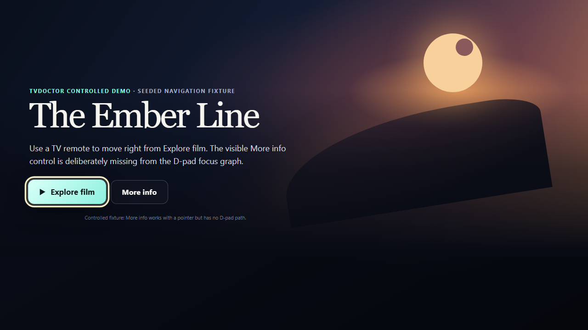

# TVDoctor sample report

This is a sanitized excerpt from the packaged `tvdoctor demo` fixture. Northstar
is deliberately broken so a new user can see a complete audit and deterministic
replay before testing their own application. This is controlled fixture evidence,
not a compatibility or accuracy claim for production TV applications.

## Verdict

**VERIFIED navigation failure found.** The navigation audit completed its bounded
demo surface: 6 remote actions, 1 focus state, 1 finding, and no evidence failures.

| Field | Result |
| --- | --- |
| Rule | `remote.reachability` |
| Severity | Medium |
| Screen | Home |
| Starting focus | `Explore film` (`hero-watch`) |
| Remote action | `RIGHT` |
| Expected | Focus moves to the visible `More info` control |
| Observed | Focus remains on `Explore film` |
| Evidence | Before/after screenshot + transition/UI excerpt |
| Portable replay | Available |
| Replay result | **REPRODUCED** |



The screenshot is intentionally unchanged after `RIGHT`: that is the failure.
`More info` is visible and pointer-operable, but the D-pad focus graph has no route
to it. TVDoctor records the transition, the aligned candidate, screenshots, and a
portable replay rather than treating the self-loop as a clean navigation result.

## Reproduce it locally

After installing TVDoctor and its matched Chromium runtime:

```sh
tvdoctor setup
tvdoctor demo
```

The demo starts a loopback-only packaged fixture, runs the real quick navigation
engine, writes the normal report bundle, verifies this exact seeded finding, then
executes the stored replay while the fixture is still running. The command exits
successfully only when the audit completes and replay classifies the issue as
`REPRODUCED`.

Typical terminal proof:

```text
Packs 1/1 completed
Actions 6/300
States 1; issues 1; evidence failures 0
Seeded More info D-pad failure VERIFIED
Checkpoint PASS
RIGHT dispatch PASS
Replay classification REPRODUCED
Demo VERIFIED: the seeded D-pad failure was found with deterministic evidence.
Replay: REPRODUCED
```

The generated HTML report contains the full evidence bundle. Runtime-specific
loopback ports, timestamps, and machine paths are omitted from this checked-in
sample.
